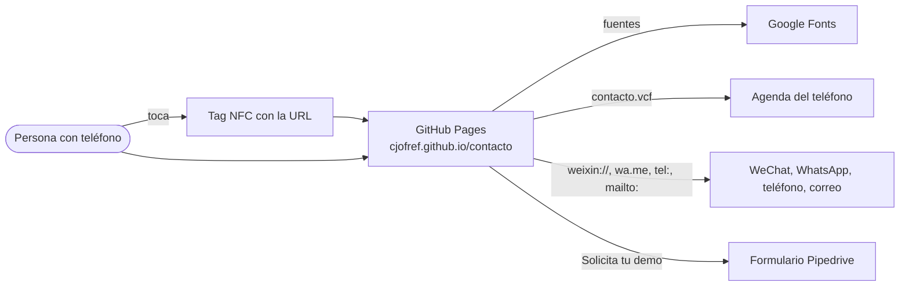
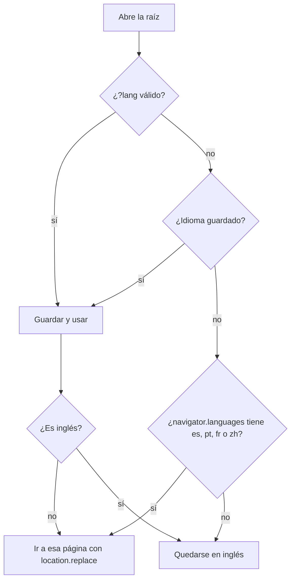

# Arquitectura v0.1.0 — NFC Contact

Documento en markdown con diagramas mermaid; la versión LaTeX queda pendiente. Decisiones en [ADR-0001](../adr/ADR-0001-sitio-estatico-github-pages.md).

## 1. HLD

**Qué es**: un sitio estático que un tag NFC abre y que entrega el contacto de Cristóbal Jofré. **Actores**: quien toca la tarjeta (iPhone o Android), Cristóbal (edita datos y publica) y GitHub Pages (hosting).

Decisiones macro: sitio estático sin framework ni analytics, generador versionado, vCard 3.0 único (ADR-0001).

## 2. LLD

| Módulo | Ruta | Función |
|---|---|---|
| Datos de textos | `i18n/strings.json` | Fuente única de las 5 páginas (`en`, `es`, `pt-BR`, `fr`, `zh-Hans`) y de `wechatId` |
| Plantilla | `templates/page.html` | HTML con claves `{{…}}` y los scripts mínimos |
| Generador | `scripts/build-pages.mjs` | `buildPages({strings, template})` devuelve ruta→HTML; falla si falta una clave; escribe las páginas |
| Contacto | `contacto.vcf` | vCard 3.0: N, FN, ORG, TITLE, TEL, EMAIL, URL, WeChat, X-SOCIALPROFILE, ADR, PHOTO |
| Validador | `scripts/validate-vcard.mjs` | Exige CRLF, FN, TEL y líneas de 75 octetos como máximo; `test/vcard.test.mjs` fija además WeChat, LinkedIn y la ausencia de `TZ` |
| Foto | `scripts/embed-vcard-photo.mjs` | Embebe `assets/vcard-photo.png` en `PHOTO` (idempotente) |
| Estilos | `css/styles.css` | Tema oscuro con variables `--mo-*` |
| Pruebas | `test/*.test.mjs`, `test/e2e.mjs` | `node:test` y Playwright móvil (390×844 y 360×640) |

Páginas generadas: `index.html`, `es/index.html`, `pt/index.html`, `fr/index.html`, `zh/index.html`.

## 3. Flujos

Ver [docs/diagrams/landing-nfc.md](../diagrams/landing-nfc.md). Regla de idioma en la raíz: `?lang=xx` válido, si no el idioma guardado en `contacto.lang`, si no el primer idioma soportado de `navigator.languages` (`zh-TW` y `zh-HK` van a `/zh/`), si no inglés.

## 4. Interacción entre componentes

Edición: `i18n/strings.json` + `templates/page.html` → `scripts/build-pages.mjs` → 5 páginas versionadas → `git push origin main` → GitHub Pages. Botón de WeChat: el clic copia `cjofre13` al portapapeles, muestra un aviso en el idioma de la página y navega a `weixin://dl/chat?cjofre13`; si el portapapeles falla, el aviso queda con «Abrir WeChat».

## 5. Tecnología (capas Technology y Application)

- Hosting: GitHub Pages desde `main`, raíz, con HTTPS; `contacto.vcf` se sirve como `text/x-vcard`.
- Dependencias de entrega: Google Fonts (no en chino). Sin base de datos, sin servidor propio, sin API.
- Peso: cada página con CSS y assets, menos de 300 KB (prueba HTML).

## 6. Schema de BD

No aplica: el sitio no tiene base de datos.

## 7. Seguridad

- Superficie: solo archivos estáticos públicos; sin formularios propios ni secretos.
- Los datos del vCard (celular, correo corporativo, web, WeChat, LinkedIn) son profesionales y públicos; no se publican dirección ni cumpleaños.
- Los enlaces externos del botón de demo llevan `target="_blank" rel="noopener"`.
- `localStorage` guarda solo el código de idioma bajo la clave `contacto.lang`, con `try/catch`.
- El tag NFC no se bloquea hasta probarlo en iPhone y Android ([docs/nfc-grabado.md](../nfc-grabado.md)).

## Crítico

| Ruta | Motivo | Evidencia | Visto en |
|---|---|---|---|
| `contacto.vcf` | la fase publica el sitio hacia afuera (push a Pages) y el vcf publicado queda en manos de terceros. Dos pasos requieren confirmación manual (5.4 y 5.5). Además, `/Users/cjofre/Projects/NFC_Contact` no es un repo git, así que 5.1 (commit y `git push origin main`) puede fallar sin un remoto configurado. | irreversibilidad (envío hacia afuera) y verificabilidad (el resultado solo se ve en producción y en teléfonos reales). /Users/cjofre/Projects/NFC_Contact/contacto.vcf:7 publica el celular `+56931929011` y el email de la línea 8, que son datos personales. La línea 3 lleva `N;CHARSET=UTF-8:Jofré F.`, y H6/CA-8 dependen de que iOS y Android la lean bien. Una vez publicado y grabado en un tag, el vcf queda en manos de terceros. /Users/cjofre/Projects/NFC_Contact/index.html:37-38 repite el mismo número en `tel:` y `wa.me`. Sin tests que cubran el entorno publicado: `test/e2e.mjs:14` toma `BASE_URL`, pero la prueba en iPhone y Android (5.5) es solo manual. | fase-5 @ 6ff5c59 |
| `index.html` | la fase reescribe el contrato público de 5 páginas, publica en vivo y es la base del tag NFC. Además toca el vCard y las pruebas que lo verifican. | scripts/build-pages.mjs (todavía no existe, se crea en 7.2) pasa a ser el generador único de index.html y de cuatro páginas nuevas. Todas son contrato público, porque son la URL que se graba en el tag NFC (.turbo/plan/nfc-landing-m1/plan.md:43). index.html:1-75 es la página actual y pasa a ser salida generada. La fase la sobrescribe, y hoy la cubre test/html.test.mjs, que asume una sola página. Irreversibilidad: 7.8 hace `git push origin main` y publica en vivo, y 7.4 hace commit de contacto.vcf. Una URL grabada en el tag se puede romper si cambia la ruta. El repo no es git, así que `git status` y los commits de 7.4 y 7.8 dependen de que exista un remoto (no lo verifiqué). Dominio y verificabilidad: la redirección por idioma (`navigator.languages`, `localStorage`) solo se verifica con Playwright. El mensaje de WhatsApp depende del idioma, y el contraste mínimo 4,5:1 y el límite de 300 KB se fijan en pruebas que hay que reescribir. No hay ADR, sección `## Crítico` ni contexto de memoria. | fase-7 @ 270f5c9 |
