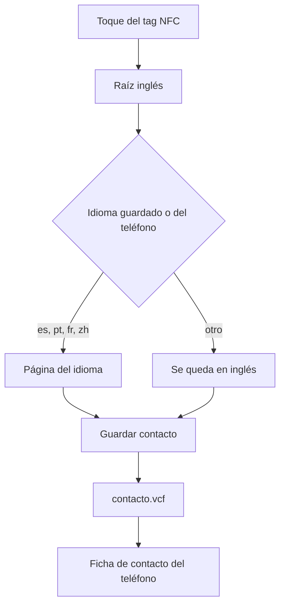
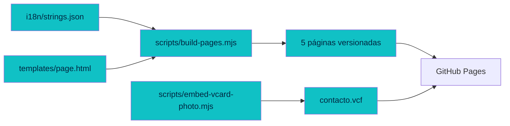

# v0.1.0 — Landing NFC de Monitor One con descarga de contacto (2026-11-21)

Plan: `.turbo/plan/nfc-landing-m1` · ADRs: ADR-0001, ADR-0002

## Qué se hizo y por qué
Un tag NFC abre `https://cjofref.github.io/contacto/`, una landing estática de Monitor One donde Cristóbal Jofré queda guardado en la agenda en dos toques (O-1 a O-4 del plan). Se construyó en fases:

1. **Base y spike (fase 1)**: repo `cjofref/contacto`, logos optimizados y Pages activo. H4 confirmada: `contacto.vcf` se sirve con `content-type: text/x-vcard`.
2. **vCard (fase 2)**: `contacto.vcf` 3.0 con `scripts/validate-vcard.mjs` y `test/vcard.test.mjs` (CRLF, FN, TEL y largo de línea).
3. **Landing y pruebas (fases 3 a 5)**: página mobile-first, pruebas HTML y e2e Playwright (390×844 y 360×640), publicación y verificación en vivo con sha256 igual al local.
4. **Rediseño oscuro en 5 idiomas (fase 7)**: tema de las charlas con fondo de nodos, `i18n/strings.json` como fuente única, `scripts/build-pages.mjs` con salida versionada, selector de banderas, recuerdo del idioma y redirección solo en la raíz. Google Fonts se omite en chino (limitación para los otros idiomas en ADR-0001).
5. **WhatsApp y WeChat (fase 8)**: mensaje prellenado con el idioma de la página más español; botón de WeChat que copia `cjofre13` y abre la app, ancho en `/zh/` y círculo en las demás.
6. **vCard ampliado (fase 9)**: ID de WeChat como URL `weixin://dl/chat?cjofre13` con etiqueta, LinkedIn solo como perfil social (`X-SOCIALPROFILE`; Android lo ignora) y foto del logo embebida con `scripts/embed-vcard-photo.mjs`. La zona horaria se descartó por decisión de la persona.
7. **Documentación y grabado (fase 6)**: `docs/nfc-grabado.md`, README, ADRs, arquitectura y este changelog. El tag ya está grabado y funciona (confirmado por la persona).

## Flujo principal

## Interacción entre componentes

Todo lo marcado es nuevo en esta versión; no hubo componentes previos.

## Integraciones agregadas/cambiadas
- **GitHub Pages**: hosting desde `main`, raíz, HTTPS.
- **Google Fonts**: Montserrat y Lato, salvo en `/zh/`.
- **WhatsApp**: `https://wa.me/56931929011?text=…` con mensaje por idioma.
- **WeChat**: URL `weixin://dl/chat?cjofre13`; no permite agregar por ID desde un enlace web, el botón solo abre la app.
- **Pipedrive**: «Solicita tu demo» abre el formulario con `target="_blank" rel="noopener"`.

## Lecciones
- `node --test` descubre `test/e2e.mjs`: sale 0 bajo `NODE_TEST_CONTEXT` y se corre aparte con un servidor.
- El origen `cjofref.github.io` es compartido por todos los sitios Pages de la cuenta, de ahí la clave `contacto.lang` en `localStorage`.
- `scrollWidth` no detecta desbordes dentro de `.card-page`; el e2e mide los elementos.
- Android no muestra `X-SOCIALPROFILE`: LinkedIn solo aparece en iPhone (decisión aceptada).
- La hoja de Google Fonts bloquea el renderizado y `display=swap` no lo evita (limitación de ADR-0001).

## Pruebas
`node --test` (vCard, generador, HTML y estilos) y `node test/e2e.mjs` en local y contra el sitio publicado. Prueba manual de la persona en iPhone y Android: idioma, WhatsApp, WeChat, contacto y tag NFC.

## Schema de BD
No aplica.
